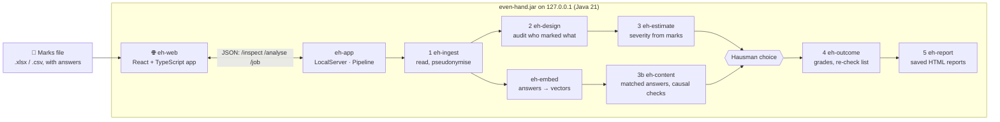

# Even Hand

**Did it matter which TA marked the script? And if it did, why?**
A grading-consistency audit for IIT Madras courses, validated on real double-graded student answers.

CS5013 project · Team *God's Eye* · Mohamed Zayaan S (CE23B092), Pruthviraj Milind Chougale (CE23B104)
Stakeholder: Prof. Aslam Kunhi Mohamed, Department of Civil Engineering · <https://github.com/Zayaan3019/Even_Hand>
Project site: <https://even-hand.vercel.app> (the app itself runs on your own computer; see below)

Large courses here are marked by teams of TAs who split the scripts. Part of what a student is
awarded then depends on whose pile the script landed in. Under relative grading (B at the class
mean, A one SD above, top 10% S) that is zero-sum: a leniently marked student who rises into a band
pushes a harshly marked one out of it.

From the marks file the course already keeps, with the students' written answers if it has them,
Even Hand answers five questions:

1. **Can this marking be checked at all?** Decided from *who marked what*, before any mark is read.
2. **How differently did the TAs mark?** Each TA's severity in marks, with a 95% interval.
3. **Was it the answers or the marking?** Answers that say the same thing are compared across TAs, so
   a pile of stronger answers is never mistaken for a lenient TA. Each TA's difference is split into
   *what students wrote* and *how it was marked*, with checks that say how far that can be trusted.
4. **What did it do to grades?** The course regraded under its own rule, as if every script had been
   marked by an average TA.
5. **Which scripts should be looked at again?** At most 20, most consequential first, plus the
   near-identical answers that got different marks. **Even Hand never changes a mark.**

## For professors and TAs: three steps, no training

1. **Open it.** Double-click `even-hand.cmd` (Windows) or run `./even-hand.sh` (macOS, Linux). Your
   browser opens Even Hand at `http://127.0.0.1:8642`, served by your own computer. Nothing is sent
   anywhere. The first start builds it and fetches the answer-reading model once (a few minutes, with
   internet); after that it starts in seconds and works offline.
2. **Drop in your marks file.** The Excel workbook or CSV you already keep, or your exam platform's
   export, with a column saying which TA marked each script. Even Hand shows what it read (students,
   TAs, questions, written answers) and anything to fix, in plain words, and asks how much each exam
   counts.
3. **Press *Check the marking*.** A progress bar follows the analysis. The results open on a one-paragraph
   **bottom line**, with sections for the TAs, why marks differed, the evidence from the answers,
   grades and the re-check list. Every chart has a *How to read this* note. Real roll numbers and TA
   names appear on your screen only. **Save report** and **Save Class Committee sheet** save copies
   with pseudonyms only, safe to file or forward; **Print** prints the full report.

Java 21 or newer is the only requirement (<https://adoptium.net>).

### What the file can look like

| Your file looks like | Example header | When |
| --- | --- | --- |
| One row per student | `roll_no, ta, Q1 (10), Q1 answer, Q2 (15), Q2 answer` | Each TA marked whole scripts (most courses). Write each question's maximum in brackets. Answer columns are optional. |
| One row per answer | `roll_no, assessment, question, max_marks, marks, ta, answer` | TAs split the paper by question, or some scripts were marked twice. |
| Moodle / LMS quiz export | `Q. 1 /10.00`, `Response 1`, …, `Graded by` | As exported, plus a *Graded by* column. |
| Google Forms quiz export | `Score` (`31 / 40`), the answer columns, `TA` | As exported, plus a *TA* column. |

- **Answer key.** A row whose roll number is `KEY` holds your model answers. Even Hand uses it as a
  reference for what a good answer says, never as a student.
- **Excel** workbooks (`.xlsx`, first sheet) are read directly, as are CSV files (`CSV UTF-8` from Excel).
- Column names are matched loosely (`Roll No`, `roll-no`, `TA`, `marker`, `evaluator`, `Graded by` …).
- A blank cell or `AB` means not answered.
- Roll numbers, e-mails and TA names written *inside* answers are removed before anything reads them.

## How it decides that the marking, not the answers, caused a difference

A difference between two TAs' piles has two possible causes: one pile's students wrote better
answers (legitimate), or one TA marked the same work differently (a marking effect). Even Hand reads
every written answer with a sentence-embedding model (all-MiniLM-L6-v2, run on your computer by our
own Java implementation). It then compares each answer with the most similar answers **marked by other
TAs**. Once two answers say the same thing, what was written cannot explain a gap in their marks.
This is a matching estimator with regression adjustment from causal inference (Abadie & Imbens), and
the report shows the checks that say how far it can be trusted:

- **Decomposition**: each TA's raw gap = what students wrote + how it was marked + neither.
- **Overlap and balance**: does each TA have comparable answers marked by others, and are matched
  answers equally good?
- **Negative control**: answer length, which a TA cannot affect and which nothing adjusts for.
- **Double-marked scripts**: identical content, two TAs.
- **Placebo**: TA labels shuffled among similar answers; the method must then find nothing.
- **Rosenbaum sensitivity Γ**: how much hidden quality difference would overturn the conclusion.
- **Mechanism**: consistent severity, a different reading of one question's rubric, drift, isolated slips, or chance.

When the marks alone can compare the TAs only by assuming their piles were alike, a **Hausman test**
compares the marks-only and the answer-based estimates:

- If they agree, the answers confirm the assumption, and the more precise marks estimate is used.
- If they disagree, the piles were not alike, and the answers' estimate is used.

The full method, with references, is in [docs/METHOD.md](docs/METHOD.md).

## How accurate it is

Measured on **real** student answers that two people graded independently: the UNT short-answer
dataset (Mohler, Bunescu & Mihalcea, ACL 2011; 2,273 answers, 81 questions). Because both graders
marked everything, the true difference between them is known. Each run deals every script to one
grader only, as a course does, and asks Even Hand to recover what the double grading shows.
Settings were tuned on half the questions and every figure below is measured on the other half.

| Scenario | Pile averages | Marks only | **Even Hand** | 95% intervals contain the truth | False alarms / found |
|---|---|---|---|---|---|
| Two real graders, random deal | 0.67 | 0.68 | **0.76** | 100% | finds the real gap in 97% |
| No difference, unfair piles | 5.28 | 4.94 | **1.53** | 99% | **0%** false alarms |
| Planted 10-point gap, unfair piles | 4.98 | 4.53 | **1.61** | 96% | finds it in 100% |
| Four TAs, unfair piles | 5.21 | 4.08 | **2.05** | 93% | finds them in 99% |

Error in percentage points of a question's maximum (RMSE). When piles differ in quality, comparing
pile averages, or the marks alone, is off by about 5 points; comparing answers that say the same thing
brings it to about 1.5–2. When piles were dealt at random the marks alone are already good and are kept.

Full tables, scenarios and the reproduction script (`sh scripts/validate.sh`) are in
[docs/VALIDATION.md](docs/VALIDATION.md).

## Privacy and security

- **Nothing leaves the computer.** The server listens on 127.0.0.1 only, and an architecture test
  forbids any other network use in the code. The page loads only its own files: its
  Content-Security-Policy allows no third-party script, style or connection.
- **No other website can use it.** Requests must name this server (`Host`, which defeats DNS
  rebinding) and must come from its own page (`Origin`).
- **Identities are pseudonymised at the first step** (keyed HMAC-SHA-256). Saved reports carry
  pseudonyms only. The pseudonym key exists in memory for one run, unless sealed under a passphrase
  (AES-256-GCM, `--seal-key-with-env`).
- **Nothing is written to disk** unless you save a report.
- **Untrusted files are handled defensively.** CSV fields that span lines are read correctly, and an
  unclosed quote is reported. Excel files are opened with a size cap against zip bombs and with XML
  external entities disabled. The answer-reading model is checked against a pinned SHA-256 before use.

## Architecture



| Module | What it does |
| --- | --- |
| `eh-core`, `eh-numerics` | Shared types (sealed audit verdicts, `FittedModel`), exact rank arithmetic, Cholesky, distribution tails |
| `eh-ingest` | CSV (RFC 4180) and Excel reading, every layout and platform export, answer keys, pseudonyms, scrubbing identities out of answers |
| `eh-design` | The audit: can TA severity be separated from student ability (exact integer rank), and could it have moved anyone |
| `eh-estimate` | Severity from the marks: additive model by backfitting, student bootstrap, design-preserving no-effect test |
| `eh-embed` | Answer text to vectors: BERT tokenizer and forward pass in Java (SIMD via the Vector API), matching sentence-transformers to cosine > 0.99999; lexical fallback |
| `eh-content` | Matched-answer severity, pooled quality model, bias-aware intervals, Hausman choice, and the causal checks |
| `eh-outcome` | Grades under the course's own rule, as marked and corrected; the gated re-check list |
| `eh-report` | Self-contained HTML reports: instructor, and Class Committee (aggregates only) |
| `eh-web` | The web app: React 18 + TypeScript + Vite; built by Maven with a pinned Node, served from the jar |
| `eh-app` | `LocalServer` (jobs, security headers, static app), `Pipeline`, `ResultJson`, the command line |
| `eh-validation` | **Not part of the product**: real-data validation and the simulation benchmark |

## Command line

```
./mvnw -q package -DskipTests
java --add-modules jdk.incubator.vector -jar eh-app/target/even-hand.jar run marks.xlsx --weights "Quiz 1=25,Quiz 2=25,End-sem=50"
java -jar eh-app/target/even-hand.jar model      # which answer-reading model is installed
```

`run` prints the audit, each TA's severity, why marks differed and the re-check list (real names in
the terminal only), and writes `report.html` and `committee.html`. Options: `--rule relative |
relative-sigma | absolute:S=90,A=80,…`, `--name`, `--out`, `--seal-key-with-env VAR`.

## Build and test

```
./mvnw verify          # every module: Java tests, the web app's type-check, Vitest tests and build
sh scripts/validate.sh # the real-data validation (downloads the UNT dataset once; ~15 minutes)
```

The tests include:

- the Java forward pass against reference vectors from sentence-transformers;
- the statistics against courses with known answers;
- the Hausman choice;
- the server's security rules (Origin, Host, path traversal, CSP);
- every file layout, Excel included, with zip-bomb and XXE attempts;
- the web app's components rendering the server's exact JSON.

To work on the web app: run `java -jar eh-app/target/even-hand.jar serve`, then `cd eh-web && npm run dev`.

## Documents

[METHOD.md](docs/METHOD.md) (the causal design) · [VALIDATION.md](docs/VALIDATION.md) (accuracy) ·
[ARCHITECTURE.md](docs/ARCHITECTURE.md) · [CODE_MAP.md](docs/CODE_MAP.md) (where to change what) ·
[ASSUMPTIONS.md](docs/ASSUMPTIONS.md) · [BENCHMARK.md](docs/BENCHMARK.md) (simulation benchmark) ·
[DESIGN.md](docs/DESIGN.md) (the design document)

## Project site

`site/` is the public page at <https://even-hand.vercel.app>: what Even Hand does, the validation
results, real screenshots (the public UNT dataset, pseudonyms only) and how to get it. It is static
HTML and CSS with a strict Content-Security-Policy, deployed with `cd site && vercel deploy --prod`.
It never receives a marks file: the analysis runs only on the professor's computer.
