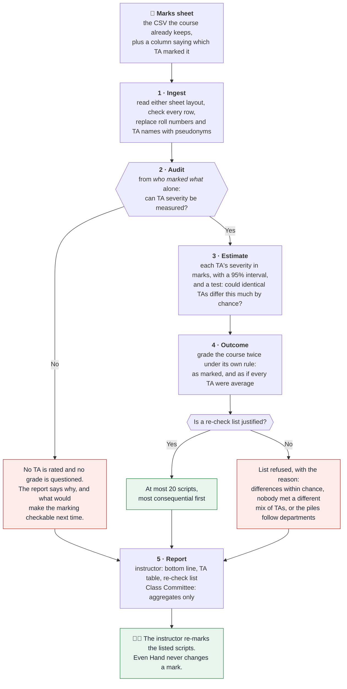
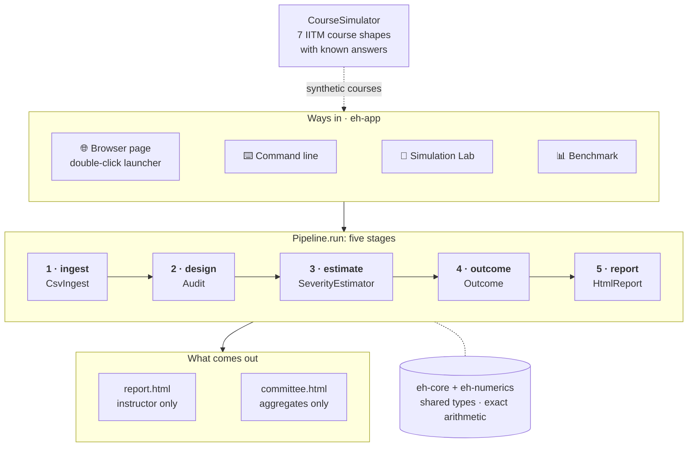
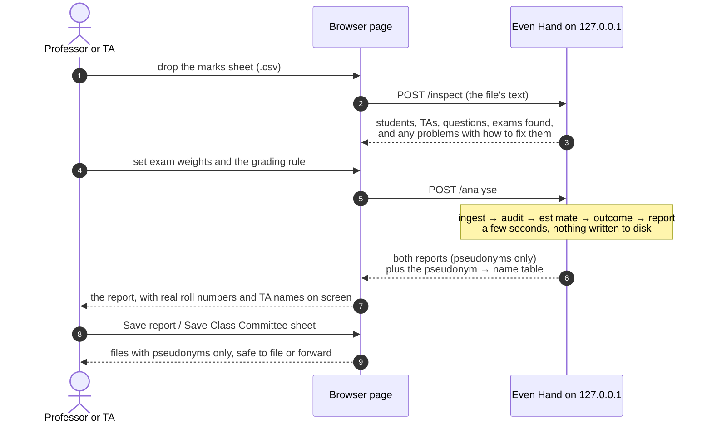
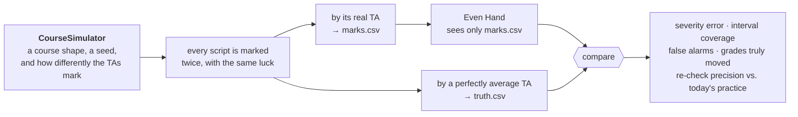

# Even Hand

**A grading-consistency audit for IIT Madras courses.**
CS5013 project · Team *God's Eye* · Mohamed Zayaan S (CE23B092), Pruthviraj Milind Chougale (CE23B104)
Stakeholder: Prof. Aslam Kunhi Mohamed, Department of Civil Engineering · <https://github.com/Zayaan3019/Even_Hand>

Large courses here are marked by teams of TAs who split the scripts. Part of what a student is
awarded then depends on whose pile the script landed in. Under relative grading (B at the class
mean, A one SD above, top 10% S) that is zero-sum: a leniently marked student who rises into a
band pushes a harshly marked one out of it.

Even Hand answers four questions for an instructor, in this order, from the marks file they
already have:

1. **Can this marking arrangement be checked at all, and could it have harmed anyone?** Answered
   from *who marked what* alone, before any mark is read.
2. **How differently did the TAs mark?** In marks, with a 95% interval for every TA.
3. **What did it do to grades?** The course regraded under its own rule, as if every script had
   been marked by an average TA.
4. **Which scripts should be looked at again?** At most 20, most consequential first. The tool
   never changes a mark; a grade changes only by a human re-mark.

## The whole project in one picture



## Run it (Java 21+, nothing else to install)

**For the professor or a TA: three steps, no training needed.**

1. **Open it.** Double-click `even-hand.cmd` (Windows) or run `./even-hand.sh`. A page opens in your
   browser. It is served by this computer only (`http://127.0.0.1:8642`), and the marks never leave it.
   If Java is missing, the window says where to get it. It rebuilds itself whenever the code has
   changed, so it always runs the latest version (the first run takes a minute or two).
2. **Drop in your marks sheet.** The one you already keep, saved as CSV, with a column saying which
   TA marked each script. Write each question's maximum in its header, like `Q1 (10)`. The page shows
   what it read (students, TAs, questions) and anything to fix, in plain words. It also asks how much
   each exam counts, with one box per exam it found.
3. **Press *Check the marking*.** The report opens with a one-paragraph bottom line. On your screen it
   shows real roll numbers and TA names. *Save report* and *Save Class Committee sheet* save copies
   with pseudonyms only, safe to file or forward.

No marks sheet to hand? Press **Try a sample course**, or **Download a blank template** to fill in.

| Your sheet looks like | Example header | When |
| --- | --- | --- |
| One row per student | `roll_no, name, ta, Q1 (10), Q2 (10), Q3 (15), Total` | Each TA marked whole scripts (most courses). Name/Total are ignored; blank or `AB` = not answered. Several exams: add an `assessment` column. |
| One row per answer | `roll_no, assessment, question, max_marks, marks, ta[, role]` | TAs split the paper by question, or some scripts were marked twice. |

Column names are matched loosely (`Roll No`, `roll-no`, `TA`, `marker`, `evaluator`, `out_of` ...),
and Excel's "CSV UTF-8" files are read as they are.

**The Simulation Lab** (`http://127.0.0.1:8642/lab`): pick a course shape, set how differently the
TAs mark, and run. The real pipeline analyses a simulated course and shows the hidden truth beside
every estimate: who marked what, each TA's true vs. estimated severity, the grades that really moved,
and the re-check list against today's practice.

**From the terminal:**

```
./mvnw -q package -DskipTests                     # builds eh-app/target/even-hand.jar
java -jar eh-app/target/even-hand.jar run samples/ce-core-7.csv --weights "Quiz 1=25,Quiz 2=25,End-sem=50"
```

```
AUDIT     Every assistant can be placed on one scale, from the marking alone.
ESTIMATE  severity, percentage points of a question's maximum (+ = harsh):
          Assistant 1   TA02         +4.3  [+2.7, +5.9]  454 marks
          Assistant 2   TA01         +1.8  [+0.1, +3.1]  456 marks
          Assistant 3   TA03         -6.1  [-7.5, -4.6]  368 marks
          no-effect test p = 0.010
OUTCOME   1.6% of the spread in totals came from who marked; 10 grade(s) would change (90% range 8-14)
RE-CHECK  13 script(s), most consequential first:
          CE23B154   Student 25    B -> C  100%  total 62.5 -> 60.2
          ...
```

(The planted truth for this sample, `samples/ce-core-7.truth.csv`: TA02 +4.1, TA01 +2.1, TA03 -6.3.
Pseudonyms such as "Assistant 1" change from run to run, because the key is drawn fresh.)

`report.html` is for the instructor only. `committee.html` is for the Class Committee and carries
aggregates only. Roll numbers appear once, in the terminal, and are never written to disk.

**Input:** either sheet shape above (see `samples/` for one-row-per-answer files). Half marks are
fine. A `role` of `second` marks a checking mark that did not count towards the grade.

**Options:** `--rule relative` (default: B at the mean, ±1/2/3 SD, top 10% S), `relative-sigma`
(no fixed S share) or `absolute:S=90,A=80,B=70,C=60,D=50,E=40`; `--name`, `--out`, and
`--seal-key-with-env VAR` to keep the pseudonym key, encrypted under the passphrase in `VAR`.

## How it works: five stages, one module each



Everything above runs on the instructor's own computer. The page is served on 127.0.0.1 only, an
architecture test forbids any other network use, and nothing is written to disk unless the
instructor saves a report.

| Module | Stage | Key class | What it does |
| --- | --- | --- | --- |
| `eh-ingest` | 1 | `CsvIngest` | Reads the CSV and replaces roll numbers and TA names with keyed pseudonyms (HMAC-SHA-256) before anything else sees them. Bad rows are reported with line numbers. |
| `eh-design` | 2 | `IdentifiabilityAudit` | Decides from the allocation alone whether TA severity is measurable (exact integer rank) and whether it could have moved anyone. Also holds `CourseSimulator`, the dataset generator. |
| `eh-estimate` | 3 | `SeverityEstimator` | Fits `mark% = mean + ability + easiness − severity` by backfitting (repeated weighted averages). Gives intervals by resampling students and a p-value by re-simulating the course with identical TAs. |
| `eh-outcome` | 4 | `Outcome`, `GradingRule` | Grades as marked vs. corrected under the course's rule, counts letters that change, builds the re-check list behind a pre-registered gate. |
| `eh-report` | 5 | `HtmlReport` | Self-contained HTML for the instructor; an aggregate-only sheet for the Class Committee. |
| `eh-app` | — | `Pipeline`, `Main`, `LocalServer`, `SimulationLab`, `Benchmark` | `Pipeline.run` is the five stages in order; the CLI, the browser page (JDK HTTP server on 127.0.0.1, no framework), the lab and the benchmark all call it. |
| `eh-core`, `eh-numerics` | — | `FittedModel`, `ExactRowSpace` | Shared types (`FittedModel` is the seam between measuring and grading) and exact arithmetic. |

### The eight modules, class by class

`eh` stands for *Even Hand*. Think of an exam office with one desk per stage, a shared dictionary
and a calculator that every desk uses, and a reception that connects them:

```
Front desk  →  Inspector  →  Analyst  →  Registrar  →  Writer
 (ingest)       (design)     (estimate)   (outcome)     (report)
        shared dictionary (core) + exact calculator (numerics)
              the building and its reception (app)
```

**1. `eh-core`: the shared dictionary.** No steps, only the words every module uses.

| Class | In plain words |
| --- | --- |
| `Response` | One mark: which student, which question, which TA, the score, out of what |
| `DesignCell`, `MarkingDesign` | Who marked what, without the marks. The audit sees only this |
| `AllocationEvidence` | Facts about how scripts were split: roll-number blocks? by department? |
| `AuditVerdict`, `Exposure` | The audit's answer: can TAs be compared, and could anyone have been affected |
| `IdentifiabilityCertificate` | Proof of the audit's check, tied to this exact course |
| `Anchoring`, `AnchoredDesign` | The convention that the TAs' severities average to zero |
| `FittedModel`, `FacetEstimates`, `Facet` | The estimates: each TA's severity, its 95% range and the no-effect p-value; numbers for one facet (students, questions or TAs) |
| `CutoffPolicy`, `LetterGrade` | The course's grading rule (relative or absolute, top 10% S) and the grades S to U with their points |
| `Diagnostic` | A message: what is wrong, how serious, how to fix it |
| `CourseProfile`, `Arrangement` | The marking set-up in words: script-wise, question-wise, and so on |
| `Provenance`, `Provenanced`, `ScoreType` | Small labels: was a setting given or assumed; what kind of marks these are |

**2. `eh-numerics`: the calculator.**

| Class | In plain words |
| --- | --- |
| `ExactRowSpace` | The audit's linear algebra in exact fractions, so a verdict never depends on rounding |
| `SymmetricEigen` | An independent floating-point method the tests use to cross-check it |

**3. `eh-ingest`: the front desk (stage 1).** Reads the file and hides identities before anyone else sees them.

| Class | In plain words |
| --- | --- |
| `CsvIngest` | Reads the CSV, finds columns by name, reports bad rows with line numbers, never guesses a question's maximum |
| `WideSheet` | Reads one-row-per-student sheets, Google Forms (`31 / 40`) and Moodle (`Q. 1 /10.00`) exports, and unpacks them to one row per answer |
| `Pseudonymiser` | Replaces identities with keyed pseudonyms: CE24B013 → "Student 12", a TA → "Assistant 3" (HMAC-SHA-256) |
| `KeyFile` | Optionally keeps that key, encrypted under a passphrase (AES-256-GCM) |
| `RollNumbers` | Reads department and order from roll numbers, to spot piles split by department or in blocks |

**4. `eh-design`: the inspector (stage 2, the audit).** Looks only at who marked what, and decides whether TAs can be compared at all.

| Class | In plain words |
| --- | --- |
| `ExposureAudit` | Could anyone be affected? Did students meet different mixes of TAs? |
| `IdentifiabilityAudit` | Can each pair of TAs be compared? Verdict: estimable, only if piles were alike, partly, or not at all |
| `DesignMatrix` | Writes "who marked what" as a 0/1 grid for the calculator |
| `DesignProfiler` | Names the arrangement in plain words for the report |
| `AuditReport` | Prints the audit's verdict for a dozen marking arrangements, without any marks |
| `DriftAudit` | Asks the same question of marking order: could a late script lose, and could we tell? |
| `CourseSimulator` | The dataset: synthetic IITM courses where each script is also marked by a perfectly average TA, so the right answer is known |
| `DesignGenerator` | Builds marking arrangements of known shape, to test the audit against answers worked out in advance |

**5. `eh-estimate`: the analyst (stage 3).** Works out how strict each TA was, how sure we are, and whether it could be luck.

| Class | In plain words |
| --- | --- |
| `Observations` | Turns every mark into a percentage of its maximum (8/10 → 80) and gives longer questions more weight |
| `Backfit` | The rounds of guessing: students, then questions, then TAs, until the numbers settle |
| `SeverityEstimator` | Runs `Backfit` once, then 200 resamples for the ranges and 99 reshuffles for the no-effect test, and returns a `FittedModel` |
| `Settings` | The dials: shrinkage (5 and 50), 200 resamples, 99 reshuffles, a fixed random seed |

**6. `eh-outcome`: the registrar (stage 4).** Asks whose grade would change.

| Class | In plain words |
| --- | --- |
| `Composite` | Each student's weighted total, as marked and as corrected (the severity given back) |
| `GradingRule` | Letter grades under the course's own rule: B at the class mean with SD bands and top 10% S, or fixed cut-offs |
| `Outcome` | Compares the two grades over the 200 resamples, keeps students who change in at least 1 in 5, ranks them, caps the list at 20, or refuses and says why (`Gate`) |

**7. `eh-report`: the writer (stage 5).**

| Class | In plain words |
| --- | --- |
| `ReportInput` | Everything the report needs, in one place |
| `HtmlReport` | The instructor report (bottom line, TA table and chart, grade changes, re-check list) and the Class Committee sheet (totals only) |

**8. `eh-app`: the building and its reception.** What you actually run.

| Part | In plain words |
| --- | --- |
| `Pipeline` | Walks the file through the five stages in order |
| `Main` | The commands: `serve` (open the page) and `run file.csv` (terminal) |
| `LocalServer` | A small web server on 127.0.0.1 only: serves the page and runs the pipeline on each click |
| `upload.html` | The page: drop a file, check what was read, set weights, read the report |
| `CourseConfig` | The instructor's choices: course name, exam weights, grading rule |
| `SimulationLab`, `lab.html` | One synthetic course through the real pipeline, with the true answers shown beside the estimates |
| `Benchmark` | Picks the shrinkage dials on training courses, then tests everything once on courses it never saw |

In one line: a shared vocabulary (`core`), an exact calculator (`numerics`), one module per stage
(`ingest`, `design`, `estimate`, `outcome`, `report`), and `app`, which connects them for the
browser, the terminal, the lab and the benchmark.

### What happens when you press *Check the marking*



Details: [`docs/ARCHITECTURE.md`](docs/ARCHITECTURE.md). Where to change what:
[`docs/CODE_MAP.md`](docs/CODE_MAP.md).

## The dataset: synthetic IITM courses with known answers

Real marks are private, so the dataset is generated, and that is what makes it useful: every
simulated script is marked twice with the same luck, once by its real TA and once by a perfectly
average one. So for every student we know the grade they *should* have got, which no real course
can tell us.

The generator (`CourseSimulator`) is built around how marking is actually divided here. It
covers seven course shapes: a CE core course like our stakeholder's, a 400-student first-year
core, a question-wise elective, a rotated PG course, lab batches by department, tutorial groups,
and two slot sections. It uses IITM roll numbers (`CE23B092`), quiz/end-sem weights, half marks,
absentees and double-marked samples. Marks come from a logistic curve with reading noise and
rounding, *not* from the model the estimator fits, so the test is honest.



```
java -jar eh-app/target/even-hand.jar simulate ce-core 7 samples/      # one course + its answers
java -jar eh-app/target/even-hand.jar benchmark                        # train, then test (~2 min)
```

**Results on 112 held-out courses** ([`docs/BENCHMARK.md`](docs/BENCHMARK.md)):

- **TA severity error:** about half a percentage point where the marking links the TAs, with 88–95% interval coverage.
- **False alarms:** 4 of 24 courses with identical TAs, and 3 of those 4 are the department-batch trap, whose list the tool refuses anyway.
- **Re-check list:** 80% of flagged scripts really had their grade moved by who marked them. Re-checking the same number of scripts *nearest a grade boundary*, which is what moderation does today, finds 46%.

The two estimator constants were trained on a separate set of 168 courses (144 used, see the
benchmark). The re-check gate was fixed in the design document before any data existed.

## Build and test

```
./mvnw verify               # all modules: 162 tests, JaCoCo coverage in */target/site/jacoco
./mvnw -Pmutation verify -pl eh-outcome   # PIT mutation testing of the grading arithmetic
java -jar eh-app/target/even-hand.jar scenarios        # the audit's verdict on twelve arrangements
```

## Privacy

Runs locally. The browser page is served by the JDK's own HTTP server bound to 127.0.0.1, and an architecture test asserts that nothing else touches the network and nothing is a network client. Identifiers become keyed
pseudonyms at ingest, numbered in digest order so a label reveals nothing about the roll list. The
only mapping back is the key file, sealed with AES-256-GCM under the instructor's passphrase. Real
marks never enter the repository: `data/` and `*.csv` are git-ignored except the synthetic
`samples/`. See [`docs/data-sharing-note.md`](docs/data-sharing-note.md).

## Documents

| Path | What |
| --- | --- |
| [`docs/DESIGN.md`](docs/DESIGN.md) | The design document as submitted (11 Sep), with a revision note |
| [`docs/Even_Hand_Architecture.pdf`](docs/Even_Hand_Architecture.pdf) | One-page architecture and data-flow diagram (source: `docs/diagrams/architecture.html`) |
| [`docs/ARCHITECTURE.md`](docs/ARCHITECTURE.md) | The system as built: stages, data flow, the seam, the decisions |
| [`docs/CODE_MAP.md`](docs/CODE_MAP.md) | Where to make a change, and the test that proves it |
| [`docs/PRESENTATION.md`](docs/PRESENTATION.md) | The 2-minute overview and likely questions |
| [`docs/submission/`](docs/submission/) | Pre-evaluation *Principles & Practices* document (PDF and its HTML source) |
| [`docs/BENCHMARK.md`](docs/BENCHMARK.md) | Dataset, training and held-out test results |
| [`docs/ASSUMPTIONS.md`](docs/ASSUMPTIONS.md) | Every assumption about a course, and the override for each |
| [`prompts/`](prompts/) | The prompts we engineer with, versioned like code |
| [`docs/log/`](docs/log/) | Weekly contribution logs |
